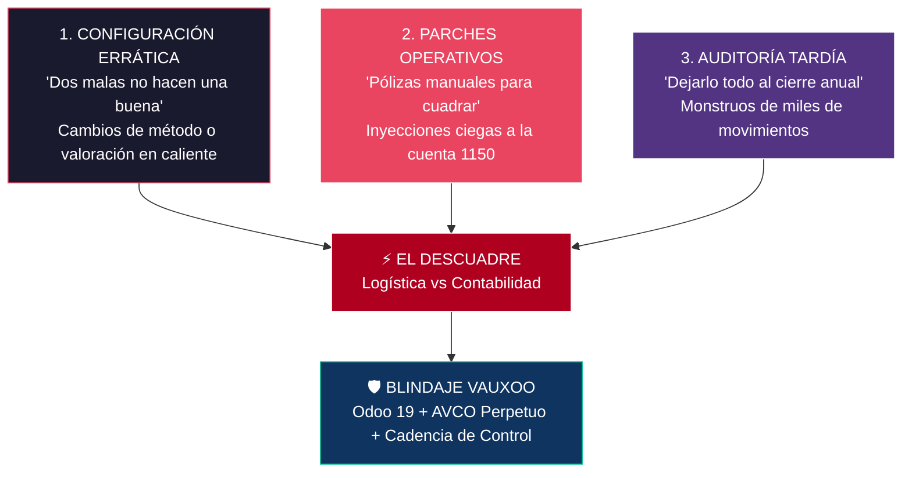
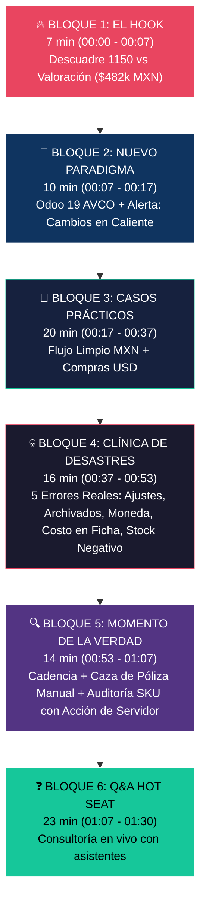

# 🎯 Plan Definitivo v7: Masterclass 2026

## "De la logística a la contabilidad: Domina la valoración de inventarios en Odoo 19.0"


---

| Dato | Detalle |
|------|---------|
| **Ponente** | Julio Serna — PM y Experto Funcional en Vauxoo |
| **Duración** | 90 minutos (1h 30min) estrictos |
| **Formato** | Virtual, en vivo |
| **Precio** | \$100 USD |
| **Versión** | Odoo 19.0 Enterprise |
| **Localización** | México — Moneda Base MXN, Plan Contable Mexicano (SAT) |
| **Método de Costeo** | Costo Promedio (AVCO) — enfoque exclusivo y perpetuo |
| **Catálogo Demo** | Hardware & Cómputo (100% Unidades Enteras · Cero NIF · Cero Landed Costs) |
| **Audiencia** | Contadores, Controllers, Consultores Odoo y Directores Financieros en México |
| **Entregables** | Certificado · Grabación HD · Checklist de Auditoría MX (con Matriz de Cadencia) · Tabla de Mapeo 18→19 · Guía Rápida de Trinchera · **Kit Técnico de Regularización & Acción de Servidor en Odoo 19** |

---

## 🧭 Marco Narrativo: Las 3 Causas Raíz del Divorcio Contabilidad-Logística

Toda la masterclass está hilada bajo las tres grandes causas reales detectadas en más de una década de implementaciones en México:



1. **Configuración (Bloque 2):** *Dos configuraciones malas no hacen una buena.* Cambiar métodos en caliente (periódico ↔ perpetuo, standard ↔ AVCO) deja brechas permanentes silenciosas porque Odoo 19 no genera asientos retroactivos automáticos sobre el stock preexistente.
2. **Operación (Bloques 1 y 5):** *El parche manual.* Ante la presión del cierre, el contador inyecta una póliza manual directa a la cuenta 1150 para forzar el cuadre, creando una fractura irreversible entre el libro mayor y el almacén.
3. **Auditoría (Bloque 5):** *El costo de la infrecuencia.* Los descuadres pequeños no atendidos se convierten en bolas de nieve inauditales. La solución es adoptar la disciplina de cadencia: Diario (Excelente), Semanal (Recomendado), Mensual (Bueno), Anual (Evitarlo).

---

## ⏱️ Cronograma Minuto a Minuto Rebalanceado (90 min)



---

### Bloque 1: EL HOOK — "El Dolor que Todos Conocen"
**⏰ 00:00 – 00:07 (7 min)**

| Elemento | Detalle |
|----------|---------|
| **Apertura** | Bienvenida de Julio Serna. Contexto: Experiencia Vauxoo en implementaciones contables e inventarios en México. |
| **Hook Visual** | Pantalla dividida en vivo: **Balanza de Comprobación (Cuenta 115.01.01)** con **\$821,100.00 MXN** vs. **Reporte de Existencias / Valoración** con **\$338,910.00 MXN**. Diferencia real de **\$482,190.00 MXN** (\$487,000 de póliza manual + \$4,810 de descuadres operativos). |
| **Pregunta al chat** | *"¿A quién le ha tocado explicarle este descuadre al Director General, al auditor externo o peor… al SAT? Pongan 🔥 en el chat"*. |
| **La Promesa** | "En los próximos 90 minutos van a dominar el Costo Promedio en Odoo 19.0. Comprenderán las 3 causas raíz que divorcian almacén y contabilidad, aprenderán a blindar sus importaciones en dólares y resolveremos este descuadre en vivo en menos de 5 minutos". |

---

### Bloque 2: EL NUEVO PARADIGMA — "Odoo 19.0 y la Trampa de la Configuración"
**⏰ 00:07 – 00:17 (10 min)**

**Contexto México y Arquitectura (6 min):**
- ¿Por qué AVCO perpetuo es la norma en México? → Deducción formal del costo de ventas ante el SAT.
- **La gran simplificación en Odoo 19:**
  - 🚫 **Adiós SVL (Stock Valuation Layers):** La valoración vive integrada directamente en cada `stock.move`.
  - 🚫 **Adiós cuentas puente interim:** Asientos contables automáticos y directos a la cuenta de inventarios 1150 en flujos estándar.
  - 🔄 **Terminología formal:** De 'Anglo-Sajona/Continental' a 'Periódico vs Perpetuo'.
  - ✅ **Nuevo menú:** *Contabilidad > Informes > Inventario / Existencias*.

**Causa Raíz #1: La Trampa de las Configuraciones en Caliente (4 min):**
- *Principio:* **"Dos configuraciones malas no hacen una buena"**.
- El error típico: Arrancar la empresa con valoración periódica (manual). A los meses darse cuenta y cambiar la categoría a perpetua.
- **Lección técnica:** Odoo 19 **NO** genera pólizas contables retroactivas de ajuste por el simple cambio de método de costeo o valuación en la categoría.
- El inventario físico anterior queda flotando sin soporte contable, creando una brecha silenciosa permanente en el balance.

---

### Bloque 3: CASOS PRÁCTICOS — "AVCO en Acción (Operación Normal)"
**⏰ 00:17 – 00:37 (20 min)**

> [!NOTE]
> Todos los flujos ya están pre-configurados en la base de datos `masterclass`. El ponente navega, resalta apuntes contables y muestra fórmulas matemáticas. Cero captura manual lenta en vivo.

**CASO 1: Flujo Limpio en MXN (8 min — 00:17 a 00:25)**
- Producto: `[TECL-INAL-USB] Teclado Ergonómico Inalámbrico`.
- Ponderación matemática limpia:
  - Compra 1: 50 u @ \$150.00 = \$7,500.00 MXN.
  - Compra 2: 50 u @ \$170.00 = \$8,500.00 MXN.
  - Costo Promedio ponderado Odoo 19: **\$160.00 MXN / pieza** (100 u = \$16,000 MXN).
- Venta y entrega de 30 unidades al cliente: Asiento automático de Costo de Ventas por **\$4,800.00 MXN** (Cargo 501.01.01, Abono 115.01.01).
- Saldo en almacén: 70 u @ \$160 = **\$11,200.00 MXN**. Balanza contable: **\$11,200.00 MXN**. Cuadre exacto en \$0.00.

**CASO 2: Compra de Importación en USD y Tipo de Cambio (12 min — 00:25 a 00:37)**
- Producto: `[MON-27-4K] Monitor Profesional 27" 4K`.
- Orden de Compra pactada a **\$100.00 USD**.
- **Recepción en Almacén:** Odoo toma automáticamente el Tipo de Cambio oficial del día de la **recepción física** (\$18.50 MXN).
- Costo unitario en almacén fijado en **\$1,850.00 MXN** (20 u = \$37,000.00 MXN).
- *Regla de Oro:* El costo contable del inventario no lo fija la fecha de la Orden de Compra ni la de la factura del proveedor; lo determina estrictamente el Tipo de Cambio al momento en que la mercancía entra a la bodega.

---

### Bloque 4: LA CLÍNICA DE DESASTRES — "5 Errores que Cuestan Millones"
**⏰ 00:37 – 00:53 (16 min)**

> [!CAUTION]
> Los 5 errores operativos y de configuración más destructivos para el balance en Odoo 19:

1. **🔥 Desastre 1: Ajuste de Inventario sin Cuenta Contable (Caso Mouse Óptico):**
   - Producto: `[MOUS-OPT-USB] Mouse Óptico Ergonómico USB`.
   - Se realiza un ajuste físico inicial de 100 piezas en categoría periódica/manual.
   - Entran 100 piezas físicas (\$8,500 MXN), pero **la cuenta 1150 queda en \$0.00**.
   - *Rastro forense:* Se detecta como "Valor no reconocido" en la auditoría.

2. **🔥 Desastre 2: Producto Archivado con Existencias (Caso Router Legacy):**
   - Producto: `[ROUT-WIFI4-LEG] Router Inalámbrico Wi-Fi 4 (Legacy)`.
   - Se compra y factura mercancía por \$2,400 MXN. Posteriormente el producto se "archiva" en el catálogo para descontinuarlo.
   - En la vista de existencias desaparece (\$0.00), pero la Balanza de Comprobación sigue cargando los **\$2,400.00 MXN**.

3. **🔥 Desastre 3: Error de Moneda — Compra en USD con Precio en Pesos (Caso Cámara Web):**
   - Producto: `[CAM-WEB-4K] Cámara Web Pro 4K`.
   - Costo normal del producto: \$1,500.00 MXN. El comprador genera la OC por error en **USD** y captura **$1,500 USD**.
   - Al recibir la mercancía a TC \$18.50, Odoo multiplica: $1,500 \times 18.50 = \mathbf{\$27,750.00\text{ MXN}}$ por pieza.
   - Por 10 unidades, el inventario se infla artificialmente a **\$277,500.00 MXN** (un sobrecosto de \$262,500 MXN por un simple error de divisa).

4. **🔥 Desastre 4: Cambio Directo de Costo en la Ficha del Producto (Caso Memoria RAM):**
   - Producto: `[MEM-RAM-16GB] Memoria RAM DDR5 16GB`.
   - Compra inicial de 10 u @ \$100 MXN (\$1,000 MXN). Un usuario altera el campo *Coste* en la ficha a mano de \$100 a **\$121 MXN**.
   - El almacén sube a \$1,210 MXN, pero la contabilidad no genera póliza. Descuadre silencioso de **\$210.00 MXN**.

5. **🔥 Desastre 5: Stock Negativo con Compra Posterior (Caso Disco SSD):**
   - Producto: `[DISC-SSD-1TB] Disco Sólido SSD NVMe 1TB`.
   - Salida urgente de mostrador de 10 discos con existencia en 0 a costo provisional (\$200 = \$2,000 MXN).
   - Días después se valida la compra de 20 discos a \$350 (\$7,000 MXN).
   - Las 10 unidades vendidas costaron realmente \$3,500 pero en libros se dedujeron a \$2,000. Quedan **\$1,500.00 MXN en el limbo**: costo de ventas subvaluado y cuenta 1150 inflada.

---

### Bloque 5: EL MOMENTO DE LA VERDAD — "Cadencia, Caza de Pólizas y Resolución"
**⏰ 00:53 – 01:07 (14 min)**

**Parte A: La Cadencia de Auditoría (5 min — 00:53 a 00:58):**
- Encuesta relámpago al chat: *"¿Cada cuánto auditan el inventario contable contra el almacén?"*
- Presentación de la **Matriz de Cadencia Vauxoo**:
  - **Diario (Excelente):** Detección inmediata en 2 minutos (1-2 movimientos).
  - **Semanal (Recomendado):** Fricción mínima, máximo 10 movimientos sospechosos.
  - **Mensual (Bueno):** Cierre contable ordenado con el checklist.
  - **Anual (¡EVITARLO A TODA COSTA!):** Acumulación de 3,000+ movimientos; laberinto inauditable.

**Parte B: Caza de la Póliza Manual y Resolución del Hook (5 min — 00:58 a 01:03):**
- Regreso a las pantallas del Hook: Descuadre de \$482,190 MXN.
- Demostración de auditoría en vivo:
  - Navegar a `115.01.01` > Apuntes Contables con filtro `Documento Origen = False`.
  - Caza del asiento manual: Póliza **`MISC/2026/09/0001`** por **\$487,000.00 MXN**.
  - La historia: *"El contador, bajo presión de cierre, inyectó la póliza para forzar el cuadre. La 'aspirina' manual envenenó el sistema"*.
- **La Trampa de la Compensación Global:**
  - Si auditas solo la suma global del almacén vs la balanza, los errores se anulan: Mouse (+\$8,500), Router (-\$2,400), RAM (+\$210), SSD (-\$1,500).
  - La conciliación es válida *únicamente* si cada producto individualmente da \$0.00 de diferencia.
- 🛠️ **Demostración de la Acción de Servidor en Odoo 19:**
  - Ejecutar acción y descargar `conciliacion_inventario.csv`. Mostrar el desglose exacto de las 7 columnas y la fórmula de cuadre SKU por SKU.
- 🛠️ **Regularización Limpia con la Plantilla CSV:**
  - Importar `plantilla_regularizacion_inventario.csv` con asignación obligatoria de `product_id`.
  - Cancelar el parche manual de \$487k. El reporte se reconcilia al centavo.

**Parte C: Las 5 Reglas de Oro Blindadas de Vauxoo (4 min — 01:03 a 01:07):**
1. 🥇 **Cero Asientos Manuales en la 1150:** Prohibir por permisos pólizas manuales directas en cuentas de inventario.
2. 🥇 **Cero Stock Negativo:** Bloquear salidas sin inventario en todas las categorías con AVCO.
3. 🥇 **Configuración y Cadencia Disciplinada:** Categorías inmutables en caliente y revisión periódica con el checklist.
4. 🥇 **Cero Cambios Manuales de Coste:** Prohibir la edición de `standard_price` en fichas de productos AVCO.
5. 🥇 **Trazabilidad Contable Obligatoria:** Si la dirección autoriza un ajuste contable en la 1150, es mandatorio capturar el campo **`Producto` (`product_id`)**.

---

### Bloque 6: Q&A "HOT SEAT" — Consultoría en Vivo
**⏰ 01:07 – 01:30 (23 min)**

- Preguntas y respuestas en vivo sobre la base de datos de Odoo 19.
- Entrega de materiales: Checklist interactivo, Guía de Mapeo, Plantilla CSV de regularización y código de la Acción de Servidor.

---

## 📋 Entregables Oficiales de la Masterclass

### Entregable #1: Checklist de Auditoría Logística-Contable
Matriz de Cadencia (Diaria, Semanal, Mensual, Anual) y 18 puntos de control operativo agrupados en 4 secciones.

### Entregable #2: Tabla de Mapeo Conceptual v18 → v19
Comparativa de arquitectura (eliminación de SVL y cuentas interim, adopción de inventario perpetuo y back-dating controlado).

### Entregable #3: Guía Rápida de Trinchera
Matriz de Diagnóstico, Solución Correctiva y Solución Preventiva para los 5 desastres operativos de almacén.

### Entregable #4: Kit Técnico de Regularización y Auditoría en Odoo 19.0
1. **Plantilla CSV de Regularización:** Importación balanceada en diario de operaciones varias con asignación obligatoria de `line_ids/product_id`:
   ```csv
   ref,date,journal_id,line_ids/account_id,line_ids/name,line_ids/product_id,line_ids/debit,line_ids/credit
   REG-INV-2026-001,2026-10-14,MISC,115.01.01,Regularizacion ajuste omitido - Mouse Optico,MOUS-OPT-USB,8500.00,0.00
   ,,,501.01.02,Contrapartida variacion inventario - Mouse Optico,,0.00,8500.00
   REG-INV-2026-002,2026-10-14,MISC,115.01.01,Regularizacion cambio costo manual - Memoria RAM,MEM-RAM-16GB,210.00,0.00
   ,,,501.01.02,Contrapartida variacion inventario - Memoria RAM,,0.00,210.00
   REG-INV-2026-003,2026-10-14,MISC,115.01.01,Regularizacion producto archivado con saldo - Router Legacy,ROUT-WIFI4-LEG,0.00,2400.00
   ,,,501.01.02,Contrapartida variacion inventario - Router Legacy,,2400.00,0.00
   REG-INV-2026-004,2026-10-14,MISC,115.01.01,Regularizacion stock negativo - Disco SSD 1TB,DISC-SSD-1TB,0.00,1500.00
   ,,,501.01.02,Contrapartida variacion inventario - Disco SSD 1TB,,1500.00,0.00
   ```
2. **Acción de Servidor (Reporte CSV):** Código Python nativo compatible con `safe_eval` para exportar la auditoría forense con las 7 columnas y la fórmula de cuadre por SKU.

---

## 📊 Historial de Ajustes al Plan

| Versión | Cambios Clave Realizados | Justificación Técnica |
|:---:|:---|:---|
| **v1** | Plan preliminar general con FIFO, AVCO, CFDI y anticipos. | Base inicial sin acotar. |
| **v2** | Eliminación de CFDI y anticipos; enfoque en AVCO. | Los CFDI de pago no impactan el costo de inventario. |
| **v3** | Caso básico MXN explícito; pedimento acotado a Landed Costs; +5 min Q&A. | Enfoque riguroso en el impacto al AVCO en Odoo 19. |
| **v4** | Integración de las 3 Causas Raíz y Matriz de Cadencia de Auditoría. | Basado en experiencia real de implementaciones. |
| **v5** | Integración Forense de Auditoría en Vivo y Matriz de 4 Fuentes. | Validación empírica sobre Odoo 19. |
| **v6** | Inclusión del Entregable #4: Kit Técnico (Plantilla CSV & Acción de Servidor). | Automatización completa de la regularización. |
| **v7** | **Alineación Completa con Catálogo de Cómputo & Casos Reales:**<br>1. Catálogo de tecnología 100% en unidades enteras (Teclado, Monitor, Mouse, Router, Cámara Web, RAM, Disco SSD).<br>2. Eliminación de menciones teóricas de NIF y Landed Costs complejos.<br>3. Inclusión del Desastre de Moneda (Cámara Web en USD con precio MXN: distorsión de \$262,500).<br>4. Rebalanceo numérico del Hook: Balanza \$821,100 vs Existencias \$338,910 (Descuadre: \$482,190 MXN).<br>5. Automatización y verificación del script de reinicio `setup_masterclass.py`. | Máxima claridad pedagógica y fidelidad con la base de datos de producción `masterclass`. |
