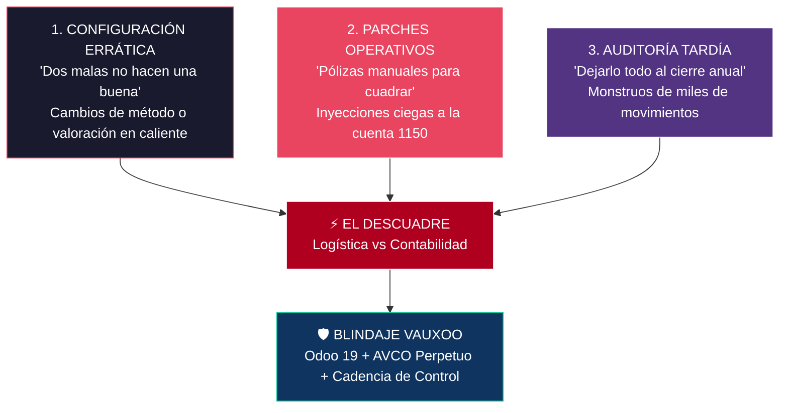
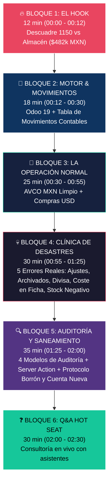

# 🎯 Plan Definitivo v8: Masterclass 2026

## "De la logística a la contabilidad: Domina la valoración de inventarios en Odoo 19.0"

---

| Dato | Detalle |
|------|---------|
| **Ponente** | Julio Serna — PM y Experto Funcional en Vauxoo |
| **Duración** | **150 minutos (2 horas de exposición + 30 min de Q&A en vivo)** |
| **Formato** | Virtual, en vivo |
| **Precio** | \$100 USD |
| **Versión** | Odoo 19.0 Enterprise |
| **Localización** | México — Moneda Base MXN, Plan Contable Mexicano (SAT) |
| **Método de Costeo** | Costo Promedio (AVCO) — enfoque exclusivo y perpetuo |
| **Catálogo Demo** | Hardware & Cómputo (100% Unidades Enteras · Cero NIF · Cero Landed Costs) |
| **Audiencia** | Contadores, Controllers, Consultores Odoo y Directores Financieros en México |
| **Entregables** | Certificado · Grabación HD · Checklist de Auditoría MX (18 puntos) · Tabla de Mapeo 18→19 & Matriz de Movimientos · Guía Rápida de Trinchera · **Kit Técnico de Regularización & Acción de Servidor en Odoo 19** |

---

## 🧭 Marco Narrativo: Las 3 Causas Raíz del Divorcio Contabilidad-Logística

Toda la masterclass está hilada bajo las tres grandes causas reales detectadas en más de una década de implementaciones en México:

1. **Configuración (Bloque 2):** *Dos configuraciones malas no hacen una buena.* Cambiar métodos en caliente (periódico ↔ perpetuo, standard ↔ AVCO) deja brechas permanentes silenciosas porque Odoo 19 no genera asientos retroactivos automáticos sobre el stock preexistente.
2. **Operación (Bloques 1 y 5):** *El parche manual.* Ante la presión del cierre, el contador inyecta una póliza manual directa a la cuenta 1150 para forzar el cuadre, creando una fractura irreversible entre el libro mayor y el almacén.
3. **Auditoría (Bloque 5):** *El costo de la infrecuencia.* Los descuadres pequeños no atendidos se convierten en bolas de nieve inauditales. La solución es adoptar la disciplina de cadencia: Diario (Excelente), Semanal (Recomendado), Mensual (Bueno), Anual (Evitarlo).

---

## ⏱️ Cronograma Minuto a Minuto Rebalanceado (120 min + 30 min Q&A = 150 min)

---

### Bloque 1: EL HOOK — "El Dolor que Todos Conocen"
**⏰ 00:00 – 00:12 (12 min)**

| Elemento | Detalle |
|----------|---------|
| **Apertura** | Bienvenida de Julio Serna. Contexto: Experiencia Vauxoo en implementaciones contables e inventarios en México. |
| **Hook Visual** | Pantalla dividida en vivo: **Balanza de Comprobación (Cuenta 115.01.01)** con **\$821,100.00 MXN** vs. **Reporte de Existencias / Valoración** con **\$338,910.00 MXN**. Diferencia real de **\$482,190.00 MXN** (\$487,000 de póliza manual + \$4,810 de descuadres operativos). |
| **Pregunta al chat** | *"¿A quién le ha tocado explicarle este descuadre al Director General, al auditor externo o peor… al SAT? Pongan 🔥 en el chat"*. |
| **La Promesa** | "En las próximas 2 horas van a dominar el Costo Promedio en Odoo 19.0. Comprenderán qué movimientos generan póliza y cuáles no, aprenderán a auditar con los 4 modelos clave y resolveremos este descuadre de casi medio millón de pesos en vivo". |

---

### Bloque 2: ARQUITECTURA & MOTOR CONTABLE — "Odoo 19.0 y los Movimientos que Sí y No Generan Contabilidad"
**⏰ 00:12 – 00:30 (18 min)**

**Arquitectura v19 y Eliminación de Interims (8 min):**
- ¿Por qué AVCO perpetuo es la norma en México? → Deducción formal del costo de ventas ante el SAT.
- **La gran simplificación en Odoo 19:**
  - 🚫 **Adiós SVL (Stock Valuation Layers):** La valoración vive integrada directamente en cada `stock.move`.
  - 🚫 **Adiós cuentas puente interim:** Asientos contables automáticos y directos a la cuenta de inventarios 1150 en flujos estándar.
  - 🔄 **Terminología formal:** De 'Anglo-Sajona/Continental' a 'Periódico vs Perpetuo'.
  - ✅ **Nuevo menú centralizado:** *Contabilidad > Informes > Inventario / Existencias*.

**Tabla Maestra de Movimientos Logísticos en Odoo 19.0 (10 min):**
Desmitificación de qué eventos operativos disparan pólizas automáticas a la cuenta de inventario (1150) y cuáles son neutros:

| Tipo de Movimiento / Documento | Modelo Odoo | ¿Genera Contabilidad a 1150? | Justificación Técnica en Odoo 19 |
| :--- | :--- | :---: | :--- |
| **Costes en Destino (Landed Costs)** | `stock.landed.cost` | **SÍ** | Incrementa el valor del inventario imputando fletes/aranceles a recepciones vinculadas. |
| **Facturas de Proveedor / Cliente** | `account.move` | **SÍ** | Reconoce costo de adquisición o deduce existencias enviando a Costo de Ventas (501). |
| **Ajustes de Inventario (Mermas / Conteos)** | `stock.move` | **SÍ** *(si configurado)* | Genera póliza si la ubicación virtual (Virtual Locations/Inventory adjustment) tiene cuenta contable. |
| **Órdenes de Producción (MO)** | `mrp.production` | **SÍ** | Acredita materias primas consumidas y debita producto terminado en almacén. |
| **Revalorización de Coste** | `stock.valuation.adjustment` | **SÍ** | Cuando se corre por asistente contable formal de ajuste de valoración. |
| **Pedidos de Venta (SO)** | `sale.order` | **NO** | Compromiso comercial; no altera existencias físicas ni saldos contables. |
| **Pedidos de Compra (PO)** | `purchase.order` | **NO** | Orden contractual; no representa devengo ni entrega física. |
| **Traslados Internos entre Ubicaciones** | `stock.picking` (internal) | **NO** | Mover de estante A a estante B dentro del mismo almacén/compañía no altera el activo. |
| **Recepciones / Entregas en Flujo Directo** | `stock.picking` | **Ver Regla** | En v19 sin interim, el impacto a 1150 se consolida con el albarán valorado o factura. |

---

### Bloque 3: LA OPERACIÓN NORMAL — "AVCO en Acción (MXN y USD)"
**⏰ 00:30 – 00:55 (25 min)**

> [!NOTE]
> Todos los flujos ya están pre-configurados en la base de datos `masterclass`. El ponente navega, resalta apuntes contables y muestra fórmulas matemáticas. Cero captura manual lenta en vivo.

**CASO 1: Flujo Limpio en Moneda Nacional MXN (12 min — 00:30 a 00:42)**
- Producto: `[TECL-INAL-USB] Teclado Ergonómico Inalámbrico`.
- Ponderación matemática limpia:
  - Compra 1: 50 u @ \$150.00 = \$7,500.00 MXN.
  - Compra 2: 50 u @ \$170.00 = \$8,500.00 MXN.
  - Costo Promedio ponderado Odoo 19: **\$160.00 MXN / pieza** (100 u = \$16,000 MXN).
- Venta y entrega de 30 unidades al cliente: Asiento automático de Costo de Ventas por **\$4,800.00 MXN** (Cargo 501.01.01, Abono 115.01.01).
- Saldo en almacén: 70 u @ \$160 = **\$11,200.00 MXN**. Balanza contable: **\$11,200.00 MXN**. Cuadre exacto en \$0.00.

**CASO 2: Compra de Importación en USD y Tipo de Cambio (13 min — 00:42 a 00:55)**
- Producto: `[MON-27-4K] Monitor Profesional 27" 4K`.
- Orden de Compra pactada a **\$100.00 USD**.
- **Recepción en Almacén:** Odoo toma automáticamente el Tipo de Cambio oficial del día de la **recepción física** (\$18.50 MXN).
- Costo unitario en almacén fijado en **\$1,850.00 MXN** (20 u = \$37,000.00 MXN).
- Factura recibida y procesada con el mismo tipo de cambio: Cero desvío cambiario contable.
- *Regla de Oro:* El costo contable del inventario no lo fija la fecha de la Orden de Compra ni la de la factura del proveedor; lo determina estrictamente el Tipo de Cambio al momento en que la mercancía entra a la bodega.

---

### Bloque 4: LA CLÍNICA DE DESASTRES — "5 Errores que Cuestan Dinero"
**⏰ 00:55 – 01:25 (30 min)**

> [!CAUTION]
> Los 5 errores operativos y de configuración más destructivos para el balance en Odoo 19:

1. **🔥 Desastre 1: Ajuste de Inventario sin Cuenta Contable (Caso Mouse Óptico - 6 min):**
   - Producto: `[MOUS-OPT-USB] Mouse Óptico Ergonómico USB`.
   - Se realiza un ajuste físico inicial de 100 piezas en categoría sin cuenta en ubicación virtual de ajuste.
   - Entran 100 piezas físicas (\$8,500 MXN), pero **la cuenta 1150 queda en \$0.00**. Descuadre: **-\$8,500.00 MXN**.

2. **🔥 Desastre 2: Producto Archivado con Existencias (Caso Router Legacy - 6 min):**
   - Producto: `[ROUT-WIFI4-LEG] Router Inalámbrico Wi-Fi 4 (Legacy)`.
   - Se compra y factura mercancía por \$2,400 MXN (8 u @ \$300). Posteriormente el producto se "archiva" en el catálogo para descontinuarlo.
   - En la vista estándar de existencias desaparece (\$0.00), pero la Balanza de Comprobación sigue cargando los **\$2,400.00 MXN**. Descuadre: **+\$2,400.00 MXN**.

3. **🔥 Desastre 3: Error de Moneda — Compra en USD con Precio en Pesos (Caso Cámara Web - 6 min):**
   - Producto: `[CAM-WEB-4K] Cámara Web Pro 4K`.
   - Costo normal del producto: \$1,500.00 MXN. El comprador genera la OC por error en **USD** y captura **$1,500 USD**.
   - Al recibir la mercancía a TC \$18.50, Odoo multiplica: $1,500 \times 18.50 = \mathbf{\$27,750.00\text{ MXN}}$ por pieza.
   - Por 10 unidades, el inventario se infla artificialmente a **\$277,500.00 MXN** (sobrecosto masivo de \$262,500 MXN por un simple clic).

4. **🔥 Desastre 4: Cambio Directo de Costo en la Ficha del Producto (Caso Memoria RAM - 6 min):**
   - Producto: `[MEM-RAM-16GB] Memoria RAM DDR5 16GB`.
   - Compra inicial de 10 u @ \$100 MXN (\$1,000 MXN). Un usuario altera el campo *Coste* en la ficha a mano de \$100 a **\$121 MXN**.
   - El almacén sube a \$1,210 MXN, pero la contabilidad no genera póliza. Descuadre silencioso de **-\$210.00 MXN**.

5. **🔥 Desastre 5: Stock Negativo con Compra Posterior (Caso Disco SSD - 6 min):**
   - Producto: `[DISC-SSD-1TB] Disco Sólido SSD NVMe 1TB`.
   - Salida urgente de mostrador de 5 discos con existencia en 0 a costo provisional (\$0 o desfasado).
   - Días después se valida la compra de 15 discos a \$350 (\$5,250 MXN).
   - La venta anticipada no reconoció el costo real al vender; quedan **\$1,500.00 MXN distorsionados en la cuenta 1150**.

---

### Bloque 5: AUDITORÍA, RESOLUCIÓN Y SANEAMIENTO REAL — "El Momento de la Verdad"
**⏰ 01:25 – 02:00 (35 min)**

**1. Los 4 Modelos / Reportes Esenciales de Auditoría ("El Cuadrilátero de Control" - 8 min):**
Para auditar inventarios, se enseña el modelo mental del **"Cuadrilátero de Control"**:
1. **Reporte de Existencias (Almacén - `stock.quant` / `stock.valuation`):** Unidades físicas $\times$ costo unitario (`standard_price`).
2. **Reporte de Facturas por Recibir / Mercancía por Facturar:** Cruce entre cantidades recibidas (`qty_received`) vs facturadas (`qty_invoiced`).
3. **Reporte Contable (Mayor de la Cuenta `115.01.01`):** Saldo oficial de Balanza y apuntes contables individuales (`account.move.line`).
4. **Movimientos de Inventario (`stock.move`):** Historial granular de cada entrada, salida y ajuste con fecha, origen, destino y valor monetario.

**2. Caza de la Póliza Manual y Resolución con Acción de Servidor (12 min):**
- Regreso a las pantallas del Hook: Descuadre de \$482,190.00 MXN.
- Filtro en cuenta `115.01.01`: `Sin Producto Asignado`. Caza del asiento del contador: Póliza **`MISC/2026/09/0001`** por **+\$487,000.00 MXN**.
- Ejecución de la **Acción de Servidor #589** con 1 clic y descarga de `conciliacion_inventario.csv`:
  - Desglose SKU por SKU explicando la diferencia de \$482,190.00 MXN al centavo (+487k póliza, -8.5k mouse, +2.4k router, -210 RAM, +1.5k SSD).
- Regularización con la **Plantilla CSV de Regularización**: asignación obligatoria de `product_id` y cancelación del parche manual.

**3. Recomendaciones Estratégicas para Saneamiento en la Vida Real (15 min):**
Comparativa práctica para sanear bases de datos en producción:
- **Vía A: El Parche Manual ("La Aspirina Destructiva"):**
  - Qué hace el contador: Póliza manual directa a la 1150 para forzar el balance.
  - Por qué falla: No arregla las existencias del almacén; en la siguiente venta el costo vuelve a desfasarse, creando un ciclo vicioso interminable.
- **Vía B: El Protocolo "Borrón y Cuenta Nueva" (La Solución Blindada Vauxoo):**
  1. *Corte Operativo:* Congelar operaciones de almacén durante la ventana de auditoría.
  2. *Descarga Total a Cero:* Ajuste de inventario llevando todas las existencias físicas a `0.00` contra una ubicación virtual transitoria de saneamiento.
  3. *Ajuste Contable a Cero:* Llevar la cuenta `115.01.01` a `$0.00` contra Pérdidas por Variación de Inventario / Resultados de Ejercicios Anteriores.
  4. *Blindaje de la Fase 0:* Congelar categorías en AVCO Perpetuo con cuentas configuradas y permisos de edición de coste bloqueados.
  5. *Carga del Conteo Físico Real:* Importar conteo físico auditado con costos promedio reales contra la cuenta transitoria de apertura.
  6. *Resultado:* Contabilidad y Almacén arrancan 100% cuadrados al centavo con trazabilidad limpia.

---

### Bloque 6: Q&A "HOT SEAT" — Consultoría en Vivo & Cierre
**⏰ 02:00 – 02:30 (30 min)**

- Consultoría en vivo con pantalla compartida: Julio Serna analiza casos y dudas complejas de los asistentes sobre Odoo 19.
- Entrega del **Kit Técnico de Regularización & Auditoría**.

---

## 📋 Entregables Oficiales de la Masterclass

### Entregable #1: Checklist de Auditoría Logística-Contable
Matriz de Cadencia (Diaria, Semanal, Mensual, Anual) y 18 puntos de control operativo agrupados en 4 secciones.

### Entregable #2: Tabla de Mapeo Conceptual v18 → v19 & Matriz de Movimientos
Comparativa de arquitectura (eliminación de SVL y cuentas interim) y Tabla Maestra de Movimientos Logísticos (cuáles generan contabilidad y cuáles no).

### Entregable #3: Guía Rápida de Trinchera
Matriz de Diagnóstico, Solución Correctiva y Protocolo "Borrón y Cuenta Nueva" para saneamiento en caliente.

### Entregable #4: Kit Técnico de Regularización y Auditoría en Odoo 19.0
1. **Plantilla CSV de Regularización:** Importación balanceada en diario de operaciones varias con asignación obligatoria de `line_ids/product_id`.
2. **Acción de Servidor (Reporte CSV #589):** Código Python nativo compatible con `safe_eval` para exportar la auditoría forense con las 7 columnas y la fórmula de cuadre por SKU.

---

## 📊 Historial de Ajustes al Plan

| Versión | Cambios Clave Realizados | Justificación Técnica |
|:---:|:---|:---|
| **v1–v6** | Evolución del plan preliminar, delimitación a AVCO México y desarrollo del Kit Técnico. | Iteraciones de diseño. |
| **v7** | Catálogo de cómputo en unidades enteras, eliminación de Landed Costs/NIFs, rebalanceo del Hook a \$482.1k MXN y script `setup_masterclass.py`. | Fidelidad técnica con la base de datos de producción `masterclass`. |
| **v8** | **Expansión a 120 min + 30 min Q&A (150 min total):** 1. Integración de la Tabla Maestra de Movimientos Logísticos en Bloque 2. 2. Integración de los 4 Modelos/Reportes Esenciales de Auditoría (Cuadrilátero de Control) en Bloque 5. 3. Integración del Protocolo Estratégico de Saneamiento: El Parche Manual vs Borrón y Cuenta Nueva. 4. Rebalanceo de tiempos de exposición: 12 min B1, 18 min B2, 25 min B3, 30 min B4, 35 min B5, 30 min B6. | Mayor profundidad didáctica, despeje de dudas sobre qué genera pólizas y guía práctica de saneamiento real. |
